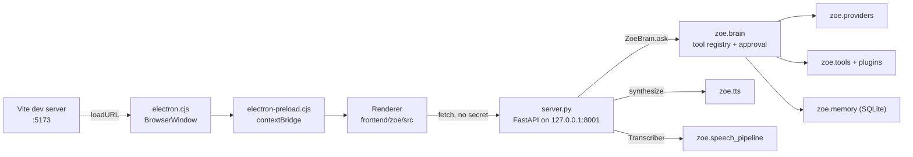
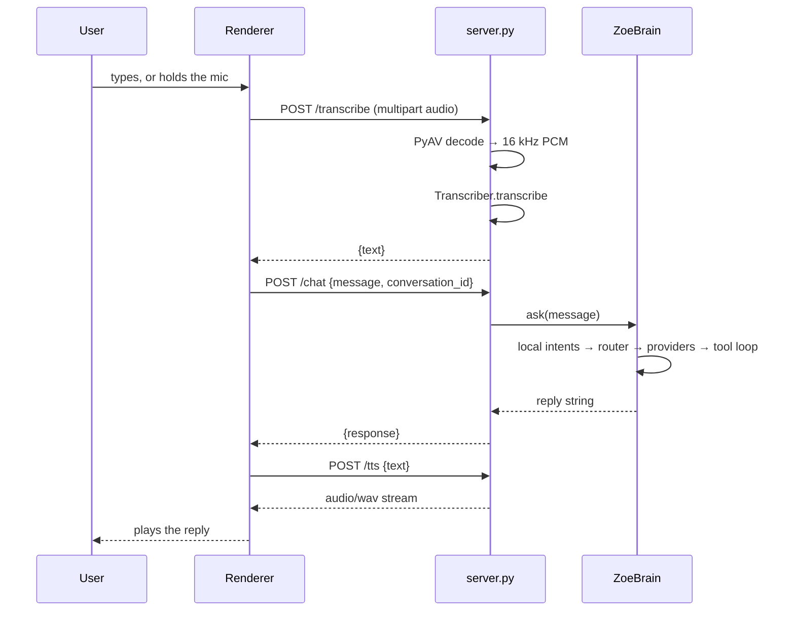

# Architecture

One process, one microphone owner, one model at a time. This document describes
the request paths as the code actually runs them, and the three state machines
and which one owns what.

## The two request paths

Both modes terminate in the same place: `ZoeBrain.ask()`. The difference is
everything before it.

```text
  VOICE PATH                                TEXT PATH
  ──────────                                ─────────
  Wake Word         wake_word.py            input()  (no microphone,
    (openWakeWord)     or skipped                      no speaker)
       │                                         │
       ▼                                         │
  Audio / VAD  audio.py  one shared stream      │
       │   VoiceActivityDetector                 │
       ▼                                         │
  Speech Recognition                              │
    speech_pipeline.Transcriber                  │
       │   faster-whisper, else Google           │
       │                                         │
       └──────────────┬──────────────────────────┘
                      ▼
             ZoeBrain.ask()   zoe/brain.py
                      │
        ┌─────────────┴──────────────┐
        │                            │
   local-intent bypass          model router
   intents/__init__.py         router.py + model_layer.py
   ┌──────────────┐                  │
   │  matched?    │                 ▼
   │  yes ────────┼──► to registry, zero LLM   providers/gemini.py
   │              │      (route="local")             providers/openai_compat.py
   │  no          │                  │                 │
   └──────────────┘                  ▼                 ▼
                              ┌───────────────┐   tool calls ──► zoe/tools/
                              │  tool loop    │                  zoe/plugins.py
                              │  (bounded by  │                        │
                              │ max_tool_     │◄─────── tool results ─┘
                              │   rounds)     │
                              └───────┬───────┘
                                      ▼
                     Memory / Vision / Tools        memory.py, vision.py
                                      │
                                      ▼
                        Text-to-Speech  (Kokoro)     speech_pipeline.py
                                      │
                                      ▼
                                   Speaker       audio.py (same owner)
```

### Voice path detail

1. **Wake Word** — `wake_word.WakeWordEngine` scores every 80 ms frame through
   the shared microphone stream. When `wake_word.enabled` is false this stage is
   skipped entirely and the loop rests in `LISTENING` instead of `IDLE`. See
   `wake_phrases.md` for which phrases are verified.
2. **Audio / VAD** — `audio.MicrophoneStream` is the *only* thing in the project
   that opens a capture device. `VoiceActivityDetector` decides when speech
   starts and ends from RMS energy above the measured room floor, plus a
   band-energy echo guard (`vad.echo_guard_enabled`).
3. **Speech Recognition** — `speech_pipeline.Transcriber` runs faster-whisper
   (`asr.model`, `asr.compute_type`) and falls back to Google Speech only if
   faster-whisper cannot be imported. `speech.asr_engine` is an inert key and
   does not select between them; see [CONFIGURATION.md](CONFIGURATION.md).
4. Everything after this point is the text path below, plus the reply.

### Text path detail

`main.run_text_mode()` calls `brain.ask(user_input)` directly. No microphone, no
speaker, no wake word. `main.run_voice_mode()` runs the voice loop, which
converges on the same `brain.ask()` once a transcript exists.

## The local-intent bypass

`ZoeBrain.ask()` runs `zoe/intents/handle()` **before** any provider call.
If the utterance matches a deterministic pattern, the matching registry tool runs
and the model is never consulted. The response is recorded in history as a
normal turn with `trace.route = "local"`.

The six intents are `time`, `weather`, `dictionary`, `screenshot`, `launch_app`
and `media_play`. Handlers dispatch through the same `TOOL_REGISTRY` the model
would use, so there is exactly one implementation of each tool.

Two things deliberately skip the bypass:

- **Ephemeral turns** (webcam perception) — a camera frame is an analysis
  request, not a user command.
- **Image turns** — same reason.

A matching pattern whose handler raises is not fatal: the turn falls through to
the model router rather than stranding the user. Doubt means fall-through.

Before the intent bypass, `ask()` also resolves two **pending confirmations**,
each driven only by the user's own next turn:

- **A staged email draft** (`Brain._resolve_pending_email`). This is the only
  route by which an email is ever sent — the model has no argument it can pass to
  send one.
- **A discovered application** (`Brain._resolve_pending_launch`), added when
  `launch_app` is asked for a name that is not in `applications.aliases`.

They are separate fields with separate timeouts (`APP_CONFIRM_TIMEOUT_S` vs
`EMAIL_CONFIRM_TIMEOUT_S`) so "yes, send it" can never also open an application.
Both are cleared on any reply, confirmatory or not.

## Application launching and discovery

`applications.aliases` is the allowlist and stays the security boundary:

```text
launch_app(name)
    │
    ├─ name in aliases?  ──yes──► argv straight from config ──► subprocess.run
    │                              (no discovery, no confirmation)
    └─ no
        │
        ▼
   apps.discover(name)   read-only scan of the installed .app bundles
        │
        ├─ 0 matches ──► refusal + how to add it. Nothing opened.
        ├─ >1 matches ─► up to 5 candidates, ask which. Nothing opened.
        └─ 1 match ────► "I found X. Shall I open it?" + pending launch
                              │
                              ▼
                    next user turn: parse_confirmation?
                              yes ──► ["open", "-a", X] ──► subprocess.run
                              no  ──► discarded
```

The confirmed launch goes through `apps.launch_bundle`, which is **not** in
`TOOL_REGISTRY` — the model cannot reach it. Its single caller is
`_resolve_pending_launch`. The command prefix is a literal and the bundle name is
one argv element, so there is no shell to interpret anything.

`scripts/list_apps.py` prints the `aliases:` block for everything installed on a
Mac. It only prints: reading its output and pasting it into `config.yaml` is a
deliberate human step, which is what keeps the allowlist a decision.

## Model routing

`zoe/router.py` scores every enabled model in `config.yaml:models` on a
weighted sum of capability fit, task affinity, measured reliability, measured
latency and configured priority. It is deterministic arithmetic: no model calls,
no ML. The top candidate that has a configured credential and the required
capabilities is tried; a retryable failure moves to the next candidate and a
non-retryable one (auth, invalid request) aborts immediately.

`verified: false` in the registry makes a model lose score, so an unconfirmed
model cannot silently outrank a confirmed one.

## The three state machines

They look similar and they are not interchangeable. Each owns something the
others must not.

### `ConversationMachine` — `zoe/conversation.py`

**Owns the voice pipeline.** Eight detailed states:

```text
  IDLE ──► LISTENING ──► TRANSCRIBING ──► THINKING ──► SPEAKING ──► FOLLOW_UP
    │          │             │                │            │             │
    │          └─────────────┴────────────────┴────────────┴─────────────┘
    │                     (cancellation / barge-in / settle)
    ▼
  ERROR ──► IDLE
```

`IDLE`, `TRANSCRIBING`, `THINKING`, `SPEAKING`, `FOLLOW_UP`, `INTERRUPTED`,
`ERROR`, `LISTENING`. `FOLLOW_UP` is the window after a reply in which the user
can keep talking without saying the wake word again.

It also owns **turn identity**. Every turn gets an id, and `is_stale(turn_id)`
is the question every audio and LLM boundary must ask before acting on work it
started earlier. A cancelled turn is stale even while still current, so a
cancelled reply can never resume. It also carries per-turn stage timings
(`speech_end`, `first_audio`, …), a bounded transition history, and a
subscription list for observers.

Only `voice_loop.py` drives it.

### `AssistantStateMachine` — `zoe/conversation.py`

**Owns the cross-mode lifecycle**: what can be observed from outside, in four
states.

```text
  IDLE ──► LISTENING ──► PROCESSING ──► SPEAKING
    ▲          │             │             │
    └──────────┴─────────────┴─────────────┘
            (cancellation / recovery)
```

`detailed_to_lifecycle()` projects the eight detailed states onto these four:
`LISTENING`→`LISTENING`, `TRANSCRIBING`/`THINKING`→`PROCESSING`,
`SPEAKING`→`SPEAKING`, everything else→`IDLE`. `PROCESSING` and `SPEAKING` may
return to `LISTENING`, because barge-in is real architecture.

One instance is shared process-wide via `get_assistant_machine()`. **It holds no
resources** — no audio, no model, no TTS handle — so `IDLE` can never unload
anything. `recover()` exists so a turn that failed mid-flight cannot leave the
lifecycle wedged in a non-idle state, which is what would otherwise make the
next turn unreachable.

Both text and voice loops drive this one; neither drives `ConversationMachine`.

### `ConversationTone` — `zoe/tone.py`

**Owns how the assistant is talking right now**, not what it is doing.

State is a mood, a conversation mode, and four scalars (energy, warmth,
curiosity, plus an internal "user state"). It is derived from the user's
messages and decays exponentially back toward the configured defaults with a
configurable half-life.

Decay is computed **lazily on read**, not on a timer, so an idle assistant costs
nothing and there is nothing to leak at shutdown.

Nothing here is ever written to memory. A mood is not a fact about a person.

### Which owns what

| | `ConversationMachine` | `AssistantStateMachine` | `ConversationTone` |
| --- | --- | --- | --- |
| Scope | voice pipeline only | every mode | every mode |
| States | 8 detailed | 4 lifecycle | mood + 4 scalars |
| Turn identity | **owns** | — | — |
| Stage timings | **owns** | — | — |
| Resources | none | none | none |
| Driven by | `voice_loop.py` | `main.py` text loop and `voice_loop.py` | `brain.py` |
| Configured by | `wake_word`, `vad`, `conversation`, `audio`, `voice` | nothing | `conversation_state` |
| Written to memory | no | no | no |

The rule behind the split: `AssistantStateMachine` is what an observer would
call "the assistant", `ConversationMachine` is what the audio pipeline knows,
and `ConversationTone` is the only one that describes a *style*. None of them
holds a device handle, so none of them can leak one.

## Module map

| Module | Responsibility |
| --- | --- |
| `zoe/brain.py` | `ZoeBrain.ask()`, `TOOL_REGISTRY`, the bounded tool loop, history |
| `zoe/audio.py` | The single owner of the microphone and speaker; device reconnection |
| `zoe/voice_loop.py` | Wake → VAD → ASR → ask → speak, with barge-in and cancellation |
| `zoe/speech_pipeline.py` | `Transcriber`, `SpeechPlayer`, playback queue |
| `zoe/tts.py` | Kokoro pipeline loader and synthesis |
| `zoe/speech.py` | Engine selection and the console fallback |
| `zoe/router.py` | Deterministic ranked model selection |
| `zoe/model_layer.py` | Provider construction from config; the registry |
| `zoe/providers/` | `base` contracts, `gemini`, `openai_compat` |
| `zoe/intents/` | `patterns` matching and `local_intents` handlers |
| `zoe/tools/` | Built-in tool implementations |
| `zoe/plugins.py` | Drop-in tool loader |
| `zoe/memory.py` | SQLite long-term facts |
| `zoe/vision.py`, `vision_change.py`, `webcam.py` | Image analysis and opt-in webcam perception |
| `zoe/conversation.py` | The two state machines |
| `zoe/tone.py` | Conversation tone and decay |
| `zoe/proactive.py` | When the assistant may speak first |
| `zoe/trace.py` | Per-turn latency spans (DEBUG-only output) |
| `zoe/logger.py` | Rotating file logging and the terminal status indicator |
| `zoe/config.py` | Every config value, read once at import |

`brain.py`, `voice_loop.py` and `audio.py` are large and cohesive. They are not
split; that is a separate change and not in scope here.
---

# The UI bridge

`server.py` is a **thin HTTP translation layer**, not a second assistant. It maps
HTTP onto `ZoeBrain.ask()` and back. Every provider decision, tool execution,
memory write and safety confirmation stays inside the brain, so there is exactly
one place where any of that can happen.



**Startup order, all manual:**

1. `python -m uvicorn server:app --host 127.0.0.1 --port 8001`
2. `npm run dev` in `frontend/zoe/` — Vite on :5173
3. `npm run desktop` — Electron loads :5173

Electron does **not** start the backend. `electron.cjs` loads the dev-server URL
unconditionally; there is no `app.isPackaged` branch, so `dist/` is built but
never loaded.

## Endpoints

| Method | Path | Does |
| --- | --- | --- |
| `GET` | `/health` | Readiness and real capability flags. Never loads a model to answer. |
| `POST` | `/chat` | One text turn through the brain. `spoken` asks for a short form. |
| `POST` | `/transcribe` | Browser audio → text. PyAV decodes WebM/Opus to 16 kHz mono PCM, then the existing local `Transcriber` runs. |
| `POST` | `/tts` | Text → streamed WAV. Audio is returned as bytes because the renderer cannot read the server's filesystem. |
| `POST` | `/conversation/reset` | Clears one conversation's context. Long-term memory untouched. |

A failed turn becomes an HTTP error carrying the backend's real reason, which the
UI renders verbatim. The bridge never invents a reply.

## Conversation identity

The renderer's conversation id indexes the server's brain pool, so the UI's chat
list and the backend's conversation context are the same thing. Ids match
`^[A-Za-z0-9_.:-]{1,64}$` and the pool is capped at 64, evicting the oldest —
client-supplied ids are untrusted input, so they are bounded rather than trusted.

## Turn sequence (UI)



Each step can fail independently, and each failure has its own wording: offline
(no backend), provider (503 from the brain), too_large (413), rate_limit (429),
timeout, or cancelled by the user's Stop. A cancelled turn is not reported as a
failed one.

## Security boundaries in the bridge

- Bound to **127.0.0.1** only.
- CORS allows **six specific localhost origins** — deliberately not a wildcard,
  because this API reaches tools that read files and launch allowlisted
  applications. Any page the user visits must be unable to drive it. Add a port
  rather than widening it.
- Caps before any expensive work: 25 MB upload, 8000-character message,
  4000-character synthesis input, 64 pooled conversations.
- `contextIsolation` on, `nodeIntegration` off; the preload exposes three
  window-control functions and nothing else.

Known gaps in the Electron shell — no `setWindowOpenHandler`, no
`will-navigate` guard, `ipcMain` handlers that do not verify the sender's frame,
and no backend process supervision — are listed in [FRONTEND.md](FRONTEND.md)
and [SECURITY.md](../SECURITY.md).
